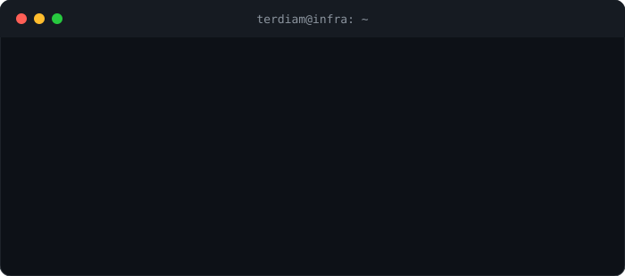

  

## 🧭 What I do

<table>
<tr>
<td width="33%" valign="top">

**🛠️ Infrastructure & DevOps**

- Kubernetes clusters, built as code
- GitOps delivery with Argo CD
- Terraform & Ansible automation
- Observability: metrics, logs, traces
- Backups, SSO, secrets management

</td>
<td width="33%" valign="top">

**⚙️ Backend**

- APIs & microservices in Go, Rust, Node.js
- gRPC, REST, WebSocket
- Event-driven systems with Kafka / RabbitMQ
- PostgreSQL, MongoDB, Redis tuning

</td>
<td width="33%" valign="top">

**🎨 Frontend & Mobile**

- Vue / Nuxt, React / Next.js, Astro
- Flutter & Kotlin mobile apps
- Dashboards and internal tools
- Desktop apps with Tauri

</td>
</tr>
</table>

## 🧰 Tech Stack

<b>🛠️ Infra & DevOps</b>

 

 

          

<b>🗄️ Databases & Messaging</b>

 

 

      

<b>⚙️ Backend</b>

 

 

   

<b>🎨 Frontend & Mobile</b>

 

## 📊 GitHub Activity

<picture>
  <source media="(prefers-color-scheme: dark)" srcset="https://github-readme-stats.vercel.app/api?username=terdiam&show_icons=true&hide_border=true&theme=tokyonight&count_private=true&include_all_commits=true" />
  
</picture>
<picture>
  <source media="(prefers-color-scheme: dark)" srcset="https://github-readme-stats.vercel.app/api/top-langs/?username=terdiam&layout=compact&hide_border=true&theme=tokyonight&langs_count=8" />
  
</picture>
 
<picture>
  <source media="(prefers-color-scheme: dark)" srcset="https://streak-stats.demolab.com?user=terdiam&hide_border=true&theme=tokyonight" />
  
</picture>

## 📌 Featured

<a href="https://github.com/terdiam/kubernaut"><picture>
  <source media="(prefers-color-scheme: dark)" srcset="https://github-readme-stats.vercel.app/api/pin/?username=terdiam&repo=kubernaut&hide_border=true&theme=tokyonight" />
  
</picture></a>

## 📫 Let's connect

Open to infrastructure, platform, and backend collaboration. Reach me by [email](mailto:6184828+terdiam@users.noreply.github.com) or through [terdiam.dev](https://terdiam.dev).

